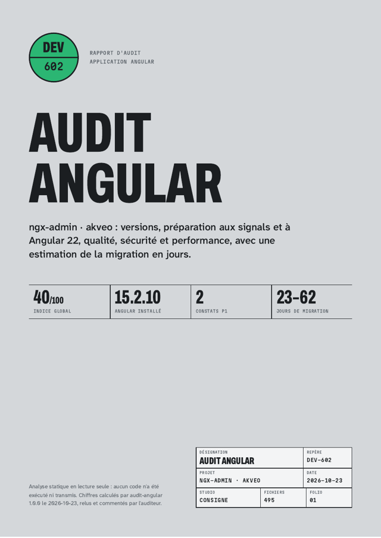

# audit-angular

Audit statique, en lecture seule, d'une application Angular. Une commande, moins d'une minute, et vous savez :

* si votre version d'Angular reçoit encore des correctifs de sécurité, et quelles dépendances bloqueront la montée ;
* quelle part de l'application est déjà au style actuel (standalone, signals, `@if` / `@for`, `inject()`, sans zone.js) ;
* ce qui expose (contournements du nettoyage XSS, `eval`, jetons en `localStorage`, secrets dans le bundle) ;
* ce qui ralentit (constructeur webpack, routes non différées, budgets absents, fichiers lourds) ;
* **combien de jours** coûte la migration vers Angular 22, lot par lot, avec la base de calcul.



Rapport d'exemple complet sur le projet open source ngx-admin : [exemples/ngx-admin/rapport.pdf](exemples/ngx-admin/rapport.pdf) ([HTML](exemples/ngx-admin/rapport.html), [Markdown](exemples/ngx-admin/rapport.md), [audit.json](exemples/ngx-admin/audit.json)).

## Installation et usage (2 minutes)

Prérequis : Node.js 20 ou plus récent. Aucune installation dans votre projet.

```bash
cd mon-application-angular
npx --yes github:consigne/audit-angular
```

ou, après `npm i -g github:consigne/audit-angular` :

```bash
audit-angular chemin/vers/le/depot -o rapport-audit
```

Sortie dans `./audit-angular/` :

| Fichier | Contenu |
|---|---|
| `audit.json` | mesures, constats et emplacements (fichier:ligne). **Jamais de code source.** |
| `rapport.html` | rapport autonome (polices intégrées, aucune ressource externe), imprimable en A4 |
| `rapport.md` | même contenu en Markdown, pour un ticket ou un wiki |
| `rapport.pdf` | avec `--pdf` (Playwright et Chromium nécessaires) |

### Options

| Option | Effet |
|---|---|
| `-o, --sortie <dossier>` | dossier de sortie (défaut `./audit-angular`) |
| `--sans-chemins` | retire tous les chemins de fichiers d'`audit.json` et des rapports |
| `--date AAAA-MM-JJ` | date de référence pour le calendrier de support (rapports reproductibles) |
| `--revue <fichier>` | intègre la revue d'un auditeur (modèle : [modele/revue.md](modele/revue.md)) |
| `--depuis audit.json` | refait les rapports depuis un `audit.json`, sans accès au code |
| `--pdf` | imprime aussi `rapport.pdf` |
| `--tickets` | exporte `tickets.csv` : un ticket par lot de migration et par constat, avec priorité et estimation (import Jira, GitLab, Azure DevOps) |
| `--seuil <n>` | code de sortie 2 si l'indice global est sous `n` (usage en CI) |
| `-q`, `-h`, `-v` | silencieux, aide, version |

### En intégration continue

```yaml
# .github/workflows/audit-angular.yml
on: [pull_request]
jobs:
  audit:
    runs-on: ubuntu-latest
    steps:
      - uses: actions/checkout@v4
      - uses: actions/setup-node@v4
        with: { node-version: 22 }
      - run: npx --yes github:consigne/audit-angular -q --seuil 60
      - uses: actions/upload-artifact@v4
        with: { name: audit-angular, path: audit-angular/ }
```

## Ce qui est vérifié

56 vérifications : 43 règles et 13 dépendances surveillées. Priorités inspirées de la gestion d'alarmes : **P1** bloque ou expose, **P2** important, **P3** à planifier, **P4** information. Chaque constat porte un identifiant stable (`VER-001`, `SEC-001`…) pour comparer deux audits.

| Axe | Exemples de règles |
|---|---|
| Versions et dépendances | version hors support ou en fin de support (calendrier officiel), paquets `@angular/*` désalignés, Material / NgRx / PrimeNG décalés, RxJS 6, TypeScript 4, TSLint, Protractor, `@angular/flex-layout`, `rxjs-compat`, `node-sass`, absence de fichier de verrouillage |
| Préparation signals et v22 | NgModules et composants non standalone, `*ngIf` / `*ngFor`, `@Input` / `@Output` / `@ViewChild` à décorateurs, injection par constructeur, dépendance à zone.js et à `NgZone`, aucun état en signals |
| Qualité et tests | mode strict, `strictTemplates`, `any`, ESLint, `console.*`, `@ts-ignore`, composants de plus de 400 lignes, composants sans test, Karma, CI, tests de bout en bout |
| Sécurité | `bypassSecurityTrust*`, `[innerHTML]`, `innerHTML =` / `document.write`, `eval` / `new Function`, jetons en `localStorage`, clés et secrets dans le code (valeurs masquées), URL `http://` |
| Performance | constructeur webpack historique, budget du bundle initial, source maps en production, part des routes différées, `*ngFor` sans `trackBy`, appels de méthode dans les gabarits, fichiers statiques de plus de 500 Ko, `lodash` complet, moment.js, jQuery |

Les indices (0 à 100) retirent 25 / 12 / 5 / 2 points par constat P1 / P2 / P3 / P4 ; l'indice global compte double les versions et la sécurité.

## Confidentialité

* L'outil **lit** les fichiers et n'écrit que dans le dossier de sortie. Il n'exécute rien (ni `npm install`, ni build, ni scripts du projet) et **n'envoie rien sur le réseau**.
* `audit.json` ne contient pas de code : des compteurs, des identifiants de règles, des chemins et numéros de ligne. Avec `--sans-chemins`, plus aucun nom de fichier.
* Les secrets détectés ne sont jamais recopiés : seule leur position est indiquée.
* `node_modules`, `dist`, `.angular`, `coverage` et `.git` sont ignorés.

## Limites

* Analyse statique : pas de couverture de tests réelle, pas de mesure de temps de chargement, pas de `npm audit`. Ces mesures demandent d'exécuter le projet.
* Les gabarits sont lus par expressions régulières (comptages fiables, pas de validation de syntaxe).
* L'estimation est un ordre de grandeur pour un développeur Angular expérimenté ; ses coefficients sont publiés dans [src/estimation.mjs](src/estimation.mjs).
* Monodépôts : lancer l'outil à la racine de chaque application (dossier qui contient `angular.json` et `package.json`).

## Audit relu par un expert

L'outil est gratuit. Si vous voulez un rapport relu, commenté et chiffré par un développeur Angular senior (défense, énergie, supervision industrielle), avec un plan de migration : **Audit Angular à prix fixe**, 100 % à distance, sans que votre code quitte vos machines. Formules, rapport d'exemple et conditions de vente : [audit-angular.pages.dev](https://audit-angular.pages.dev/). Commande : [consignestudio.gumroad.com/l/audit-angular](https://consignestudio.gumroad.com/l/audit-angular).

## Problèmes courants

| Symptôme | Cause et solution |
|---|---|
| `Aucun package.json lisible` | lancer à la racine de l'application, pas dans `src/` |
| `@angular/core introuvable` (VER-000) | dossier de bibliothèque ou d'un autre framework |
| Version lue comme `15.2.0` au lieu de `15.2.10` | pas de fichier de verrouillage : l'outil lit la plage de `package.json` |
| `--pdf demande Playwright` | `npm i -D playwright && npx playwright install chromium`, ou ouvrir `rapport.html` et imprimer en PDF |
| Faux positif | ajouter une remarque dans la revue (`--revue`) ; ouvrir une *issue* avec un extrait anonymisé |

## Développement

```bash
npm install
npm test                       # 10 tests, fixtures legacy (v15) et moderne (v22)
node scripts/exemples.mjs      # régénère le rapport d'exemple (clone ngx-admin au commit fixé)
```

Licence MIT. Polices sous SIL OFL 1.1. Calendrier de support : [angular.dev/reference/releases](https://angular.dev/reference/releases). Angular est une marque de Google LLC ; cet outil n'est ni affilié ni approuvé par Google.
